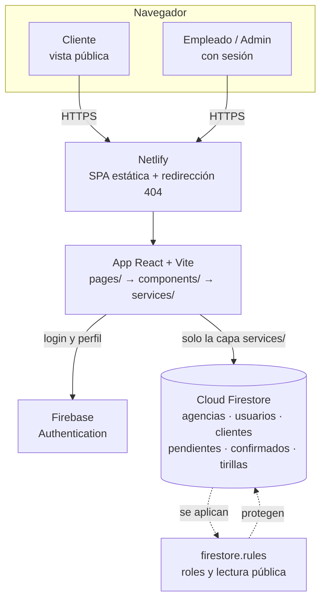

# 04 — Arquitectura

## Árbol de carpetas

```text
quini-178-362/
├── index.html               # Página base donde se monta React
├── netlify.toml             # Configuración de build y rutas SPA
├── firestore.rules          # Reglas de seguridad de la base
├── package.json             # Dependencias y comandos
├── public/
│   ├── marca/               # Logo, isotipo, favicon, banner y paleta
│   ├── media/               # Imágenes y piezas generadas con IA
│   ├── fonts/               # Nunito y Bitter autoalojadas (OFL)
│   └── img/                 # Banner para compartir
└── src/
    ├── main.tsx             # Punto de entrada
    ├── App.tsx              # Definición de rutas de la aplicación
    ├── index.css            # Tema, paleta y utilidades (Tailwind)
    ├── types/
    │   └── index.ts         # Tipos del dominio (Agencia, Cliente, Movimiento…)
    ├── context/
    │   ├── auth.ts          # Definición del contexto de sesión
    │   └── authContext.tsx  # Login, logout y perfil del usuario
    ├── components/
    │   ├── RutaProtegida.tsx    # Bloquea rutas según sesión y rol
    │   ├── NavAdmin.tsx         # Navegación del panel de administración
    │   ├── VigilanteSesion.tsx  # Cierre por inactividad (30 min)
    │   ├── LeyendaIA.tsx        # Leyenda «Generado con IA»
    │   └── PiePublico.tsx       # Pie de páginas públicas con transparencia
    ├── pages/
    │   ├── Home.tsx             # Vista pública + buscador de planilla
    │   ├── Login.tsx            # Inicio de sesión
    │   ├── ComoHicimos.tsx      # Transparencia y uso responsable de IA
    │   ├── PlanillaPublica.tsx  # Planilla del cliente (solo lectura)
    │   ├── ElegirAgencia.tsx    # El admin elige 178 o 362
    │   ├── Agencia.tsx          # Módulo Planillas de la agencia
    │   ├── FichaCliente.tsx     # Carga de créditos y débitos
    │   ├── Tirillas.tsx         # Cierre de turno
    │   └── admin/
    │       ├── Admin.tsx        # Layout del panel
    │       ├── Dashboard.tsx    # Resumen general
    │       ├── Usuarios.tsx     # Alta y edición de usuarios
    │       ├── Clientes.tsx     # Alta y edición de clientes
    │       └── Planillas.tsx    # Vista de planillas del admin
    ├── services/
    │   ├── firebase.ts          # Inicialización de Firebase
    │   ├── clientesService.ts   # Consultas de clientes
    │   ├── movimientosService.ts# Pendientes y confirmados
    │   ├── tirillasService.ts   # Cierres de turno
    │   └── usuariosService.ts   # Cuentas y roles
    ├── hooks/
    │   └── useCountUp.ts        # Animación del saldo
    └── utils/
        ├── normalizar.ts        # Mayúsculas y acentos
        ├── format.ts            # Pesos y fechas en es-AR
        └── exportar.ts          # CSV y PDF
```

## Función de cada parte

- **`pages/`** contiene una pantalla por archivo; las de `admin/` son el panel.
- **`services/`** es la única capa que habla con Firestore.
- **`components/`** son piezas reutilizables (navegación, guardas, temporizador).
- **`context/`** guarda la sesión del usuario para toda la app.
- **`utils/`** y **`hooks/`** son funciones puras y reutilizables, sin UI.

## Flujo de una petición

```text
Usuario → Página (pages/) → Servicio (services/) → Firestore
                          ← dato              ←
```

## Arquitectura en un diagrama



Leyenda:

- Todo el código viviente se publica en **Netlify** con cada `git push`.
- La única puerta a la base es la capa `services/`; las páginas nunca
  escriben `firestore` directo.
- **Firebase Auth** entrega la sesión y **firestore.rules** valida que
  el público solo lea `clientes`, `agencias` y `movimientos_confirmados`.
