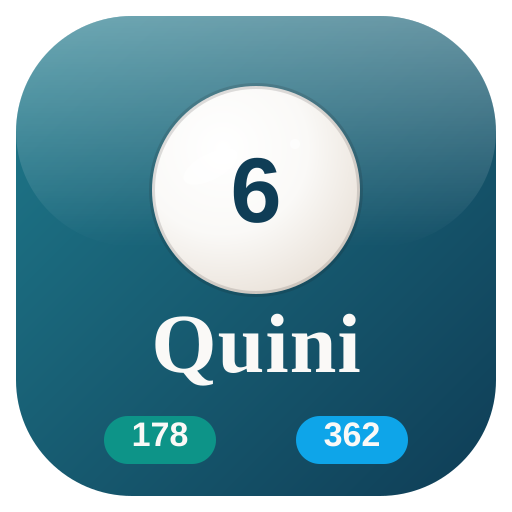

# Identidad de marca — Quini 178/362

## Esencia

| Campo | Definición |
|-------|------------|
| Nombre | **Quini 178/362** |
| Eslogan | *Las fichas de tu agencia, en orden y sin papel.* |
| Rubro | Software de gestión para agencias de quiniela |
| Personalidad | Confiable, clara, cercana y ordenada |
| Público | Dueños, empleados (agencieros) y clientes, en su mayoría adultos mayores |

### Misión

Digitalizar las fichas de las agencias de quiniela para que los
movimientos queden registrados, controlados por el dueño y disponibles
en el momento para el cliente.

### Visión

Ser la herramienta de referencia para las agencias de quiniela de la
zona, reemplazando el papel por un registro seguro, claro y accesible
para todas las edades.

### Significado del nombre

- **Quini** viene de *quiniela*, el rubro de las agencias.
- **178/362** son los números de las dos agencias que controla el sistema.

Juntos comunican que una sola plataforma ordena las dos agencias.

## Logo

El logo principal está en `../public/marca/logo-quini.svg` y combina:

- Una **bola de quiniela** sobre una **ficha digital** (representa el
  juego y su versión digital).
- La bola es blanca, con sombreado y brillo, y lleva el **número 6** en
  azul, en alusión al histórico «Quini 6» de Argentina.
- El nombre **Quini** en crema sobre el fondo azul de la marca.
- Dos etiquetas con los números **178** (verde) y **362** (celeste), los
  colores de cada agencia.

### Versiones del logo

| Versión | Archivo | Uso |
|---------|---------|-----|
| Principal | `../public/marca/logo-quini.svg` | Portada, sitio, informe |
| Isotipo | `../public/marca/isotipo-quini.svg` | Favicon, avatares, espacios chicos |
| Favicon | `../public/marca/favicon-quini.png` | Pestaña del navegador (64 px) |
| Banner | `../public/marca/banner-compartir.png` | Imagen para compartir en redes / OpenGraph (1200×630) |

Las bolas de referencia usadas para el rediseño están en
`../public/marca/referencias/` (dominio público, OpenClipart) con su detalle en
`LEEME.md`.

### Reglas de uso del logo

La IA nunca debe:

- Deformar, rotar ni recolorear el logo: se usa tal cual de `marca/`.
- Agregarle sombras, brillos ni efectos.
- Ponerlo sobre fondos de bajo contraste ni sobre el azul de marca.
- Reconstruirlo con otra tipografía ni redibujarlo.

Mínimo digital: **32 px de alto** (isotipo para espacios chicos).

## Paleta de colores

> **Actualización TP4 (26-10-2026):** la identidad evoluciona del rojo del
> TP3 a una paleta azul/teal para que el sitio y las piezas generadas
> compartan el mismo universo visual. El rojo `#E12631` se conserva solo
> para errores y acciones destructivas.

| Nombre | HEX | Uso |
|--------|-----|-----|
| Azul Quiniela | `#0F3D56` | Marca, acciones principales |
| Azul Profundo | `#092538` | Degradados y sombras de marca |
| Teal Acento | `#1F7A8C` | Acentos, enlaces y detalles |
| Crema | `#F4F0EB` | Fondo de pantallas |
| Carbón | `#171412` | Texto principal |
| Blanco Ficha | `#FAF9F7` | Tarjetas y texto sobre azul |
| Verde Agencia 178 | `#0D9488` | Agencia 178 |
| Celeste Agencia 362 | `#0EA5E9` | Agencia 362 |

El rojo `#E12631` queda reservado solo para errores, rechazos y acciones
destructivas; no es color de marca.

La paleta completa con estados está en `../public/marca/paleta.md`.

### Proporción de uso (60-30-10)

- **60 %** — fondo y superficies en Crema y Carbón (pantallas, tarjetas, texto).
- **30 %** — Azul Quiniela en acciones, encabezados y destacados.
- **10 %** — Verde (agencia 178) y Celeste (agencia 362) solo para identificar cada agencia.

### Tokens en el código

En `src/index.css`, Tailwind define los tokens con `@theme`. La IA usa
**siempre estos tokens, nunca colores escritos a mano**:

| Token (CSS / clase Tailwind) | HEX | Uso |
|------------------------------|-----|-----|
| `--color-brand-600` / `bg-brand-600` | `#0F3D56` | Azul Quiniela |
| `--color-brand-500` | `#1F7A8C` | Teal Acento |
| `--color-brand-800` | `#092538` | Azul Profundo |
| `--color-cream-100` / `bg-cream-100` | `#F4F0EB` | Crema |
| `--color-cream-50` / `bg-cream-50` | `#FAF9F7` | Blanco Ficha |
| `--color-coal-950` / `text-coal-950` | `#171412` | Carbón |
| `--font-sans: 'Nunito'` | — | Tipografía de interfaz |

El verde y el celeste de agencia se aplican con las escalas **emerald** y
**sky** de Tailwind (muy próximas a `#0D9488` y `#0EA5E9`).

Si un color cambia, se edita una sola línea en `src/index.css` y se
actualiza toda la interfaz.

## Tipografías

| Rol | Fuente | Por qué |
|-----|--------|---------|
| Títulos y logo | **Bitter** | Serif de trazos gruesos, muy legible en tamaños grandes y con personalidad |
| Cuerpo e interfaz | **Nunito** | Sans redondeada, amable y de alta legibilidad para adultos mayores |

Las fuentes oficiales (versionado variable) están autoalojadas en
`../public/marca/referencias/fuentes/` (licencia OFL, ver `LEEME.md`): así los
PNG del logo, el favicon y el banner usan la tipografía exacta de marca.

Regla: nunca otro tipo de letra. En el código, la interfaz usa Nunito
como fuente base (ver `src/index.css`).

## Tono de voz

- **Claro y directo.** Frases cortas, sin tecnicismos.
- **Cercano.** Habla de «tu agencia» y «tu planilla», como en el mostrador.
- **Tranquilizador.** Transmite orden y seguridad (por ejemplo: «Tu saldo quedó registrado»).
- **Respetuoso.** Nunca en mayúsculas sostenidas ni con diminutivos.

### Ejemplos

- Botón: **Sumar crédito** (no «Agregar item»).
- Confirmación: «Listo, cargamos el movimiento. Queda pendiente de confirmación».
- Error: «No pudimos guardar. Revisá el monto e intentá de nuevo».
